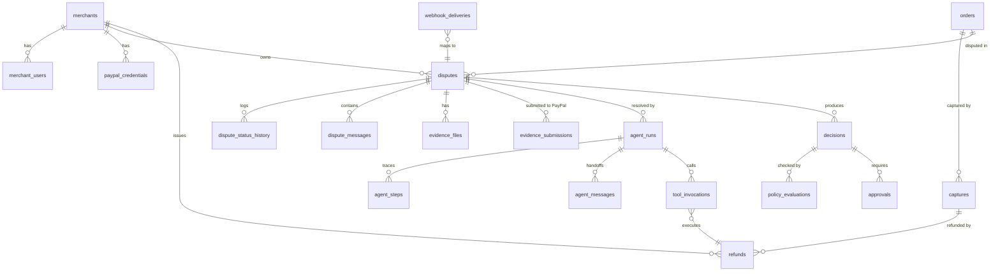

# 02 — Database Schema

Postgres 16. SQLAlchemy 2.0 async models + Alembic migrations. `pgcrypto` for `gen_random_uuid()`,
`pgvector` (optional, KB retrieval). All timestamps `timestamptz`, all money `numeric(12,2)` with an
explicit `currency char(3)` (never floats). Every tenant-scoped table carries `merchant_id uuid NOT NULL`.

## 1. ERD (core)



## 2. Tables

### 2.1 Identity & tenancy

**merchants** — one row per merchant account (one in the demo).
`id uuid pk · name text · slug text uq · paypal_merchant_id text (payer id) · currency char(3) default 'USD' · autonomy_enabled bool default true · auto_resolve_cap numeric(12,2) default 50 · auto_offer_cap numeric(12,2) default 100 · approval_required_above numeric(12,2) default 50 · risk_appetite enum('conservative','balanced','aggressive') · timezone text · created_at · updated_at`

**merchant_users** — dashboard users.
`id uuid pk · merchant_id fk · email citext uq · password_hash text (argon2id) · display_name text · role enum('owner','analyst','viewer') · is_active bool · last_login_at · created_at`

**paypal_credentials** — *never* stores plaintext secrets.
`id uuid pk · merchant_id fk · label text · environment enum('sandbox','live') · client_id text · secret_ciphertext bytea · secret_kek_id text · secret_fingerprint text (sha256 prefix, for rotation checks) · scopes text[] · webhook_id text · is_active bool · expires_hint timestamptz · created_at · rotated_at`
Constraint: only one `is_active` row per `(merchant_id, environment)`.

### 2.2 Payment facts (read-mostly mirror of PayPal)

**orders** — `id uuid pk · merchant_id · paypal_order_id text uq · intent · status · amount numeric(12,2) · currency · buyer_email_hash text · buyer_country char(2) · created_at_paypal · raw jsonb · synced_at`
**Index:** `(merchant_id, created_at_paypal desc)`.

**captures** — `id uuid pk · merchant_id · order_id fk · paypal_capture_id text uq · status enum('COMPLETED','PENDING','DECLINED','REFUNDED','PARTIALLY_REFUNDED') · amount · currency · seller_protection_status text · seller_protection_type text · final_capture bool · dispute_ids text[] · created_at_paypal · raw jsonb`
*(`seller_protection_status` is the single most important field for the Resolution agent — flag it early.)*

**refunds** — `id uuid pk · merchant_id · capture_id fk · dispute_id fk null · paypal_refund_id text uq · amount · currency · reason_code text · status enum('PENDING','COMPLETED','FAILED','CANCELLED') · idempotency_key text uq · initiated_by enum('agent','human','paypal') · tool_invocation_id fk null · created_at · completed_at · raw jsonb`

**buyers** (pseudonymous) — `id uuid pk · merchant_id · email_hash text · display_label text ("Buyer #3f2a") · lifetime_dispute_count int · prior_refund_count int · risk_note text` — unique `(merchant_id, email_hash)`. No raw PII beyond what PayPal returns; email is hashed for display and matching.

### 2.3 Disputes

**disputes** — the aggregate root.
```
id                        uuid pk
merchant_id               uuid fk not null
paypal_dispute_id         text not null            -- unique per merchant, see index
paypal_case_number        text null
order_id / capture_id     uuid fk null
buyer_id                  uuid fk null
reason_code               text        -- MERCHANDISE_OR_SERVICE_NOT_RECEIVED | ..._NOT_AS_DESCRIBED | UNAUTHORISED | ...
reason_detail             text
status                    text        -- our enum (see 01 §4)
paypal_status             text        -- OPEN | WAITING_FOR_SELLER_RESPONSE | UNDER_REVIEW | RESOLVED | OTHER
lifecycle_stage           text        -- INQUIRY | CHARGEBACK | PRE_ARBITRATION | ARBITRATION
channel                   text        -- INTERNAL | EXTERNAL
amount                    numeric(12,2)
currency                  char(3)
amount_disputed           numeric(12,2) null
response_due_by           timestamptz null      -- drives SLA + urgency sort
paypal_created_at         timestamptz
last_synced_at            timestamptz
priority                  smallint default 0    -- computed: due-date pressure + amount + reason risk
confidence                numeric(4,3) null     -- resolution agent confidence
decision_code             text null             -- REFUND_FULL | REFUND_PARTIAL | OFFER | DEFEND | ESCALATE | NO_ACTION
resolved_at               timestamptz null
recovered_amount          numeric(12,2) null     -- $ not refunded / refunded-back
version                   int default 1        -- optimistic locking
created_at / updated_at
UNIQUE (merchant_id, paypal_dispute_id)
```
Indexes: `(merchant_id, status, response_due_by)`, `(merchant_id, created_at desc)`, `(status) where status in ('AWAITING_APPROVAL','FAILED')`, GIN `to_tsvector(reason_detail)` for search.

**dispute_status_history** — append-only. `id bigserial · dispute_id · from_status · to_status · actor_type enum('system','agent','human','paypal') · actor_id text · reason text · metadata jsonb · created_at`

**dispute_messages** — buyer↔merchant↔PayPal thread (mirrors PayPal `send-message`).
`id uuid · dispute_id · direction enum('inbound','outbound') · channel enum('paypal','buyer_api','internal') · author_type enum('buyer','merchant','agent_buyer','agent_merchant','agent_resolution','system') · body text · paypal_message_id text null · sent_at · raw jsonb`
Constraint: agent-authored outbound messages must have `approved_by_run_id` non-null before `sent_at` is set.

### 2.4 Evidence

**evidence_files** — `id uuid · merchant_id · dispute_id null · kind enum('pod','tracking','invoice','policy','screenshot','correspondence','refund_proof','other') · filename · mime · size_bytes · sha256 · storage_key text (S3/local) · extracted_text text null · uploaded_by enum('human','agent','seed') · created_at`
Rules: 10 MB/file, allowlist `pdf,png,jpg,eml,txt,csv`; `extracted_text` capped at 20k chars and treated as **untrusted input**.

**evidence_submissions** — `id uuid · dispute_id · paypal_dispute_id · evidence_type text (PayPal enum) · file_ids uuid[] · note text · status enum('draft','submitted','failed') · paypal_response jsonb · idempotency_key uq · submitted_at · error_code`

### 2.5 Agent execution (observability + replay)

**agent_runs** — `id uuid · dispute_id · graph_version text · thread_id text (checkpoint) · checkpoint_id text null · status enum('QUEUED','RUNNING','INTERRUPTED','AWAITING_APPROVAL','COMPLETED','FAILED','CANCELLED') · trigger enum('webhook','manual','replay','retry') · model_primary text · started_at · ended_at · iterations int · tool_calls int · input_tokens int · output_tokens int · cost_usd numeric(10,4) · trace_url text · error_code text · error_detail text`

**agent_steps** — `id bigserial · run_id · seq int · node text · agent text · step_type enum('node_enter','llm_call','tool_call','handoff','decision','interrupt','error') · summary text · payload jsonb (redacted) · latency_ms · tokens · created_at` — unique `(run_id, seq)`.

**agent_messages** — the typed negotiation transcript. `id uuid · run_id · seq · from_agent · to_agent · msg_type enum('FINDING','QUESTION','PROPOSAL','COUNTER','ACCEPT','REJECT','VETO','DECISION') · claim text · evidence_refs uuid[] · confidence numeric(4,3) · constraints jsonb · rationale text · created_at`

**tool_invocations** — `id uuid · run_id · agent · tool text · args_redacted jsonb · status enum('ok','error','timeout','blocked_by_policy') · http_status int null · latency_ms · idempotency_key text uq null · paypal_request_id text null · result_digest text · error_code · created_at`
`blocked_by_policy` rows are gold for the demo ("the agent tried, the gate said no").

### 2.6 Decisions & control

**decisions** — `id uuid · dispute_id · run_id · decision_code · amount numeric(12,2) · currency · confidence numeric(4,3) · rationale text · cited_evidence uuid[] · policy_eval_id fk · requires_approval bool · status enum('proposed','approved','rejected','executed','superseded','expired') · created_at · decided_by enum('agent','human')`
Constraint: at most one `status in ('proposed','approved')` per dispute.

**policy_evaluations** — `id uuid · dispute_id · run_id · ruleset_version text · inputs_hash text · result enum('allow','deny','require_approval') · matched_rules jsonb (rule_id, outcome, reason) · envelope jsonb {max_amount, allowed_actions[]} · created_at`
Immutable: a decision always cites the exact ruleset version that allowed it.

**approvals** — `id uuid · decision_id · dispute_id · requested_by_run_id · status enum('pending','approved','rejected','expired') · requested_at · expires_at · resolved_at · resolved_by_user_id · note text · edited_amount numeric(12,2) null`

**audit_log** — append-only, hash-chained. `id bigserial · merchant_id · actor_type · actor_id · action text ('dispute.refund.executed') · entity_type · entity_id · before jsonb · after jsonb · ip inet · user_agent text · prev_hash text · hash text · created_at`
`hash = sha256(prev_hash || canonical_json(row))`. A nightly job (and a `GET /admin/audit/verify`) checks the chain.

### 2.7 Integration plumbing

**webhook_deliveries** — `id bigserial · provider text default 'paypal' · event_id text · event_type text · transmission_id text · payload jsonb · signature_valid bool · status enum('received','processing','processed','ignored','failed') · attempts int · last_error text · received_at · processed_at` — UNIQUE `(provider, event_id)`.

**outbox_events** — `id bigserial · topic text · payload jsonb · status enum('pending','processing','done','dead') · attempts · available_at · created_at · processed_at` — SKIP LOCKED claim pattern; no external queue needed for MVP.

**kb_documents** — `id uuid · merchant_id null (null = global) · title · kind enum('policy','faq','product','template') · body text · version int · effective_from · is_active bool`
**kb_chunks** — `id uuid · document_id · chunk_index · content text · embedding vector(1536) null · tsv tsvector` (pgvector optional; MVP can use full-text only).

**metrics_daily** (materialized) — `merchant_id · day · disputes_open · disputes_resolved · auto_resolved · approved_edits · refunded_amount · recovered_amount · avg_resolution_seconds · agent_cost_usd`

**eval_cases / eval_results** — labeled fixtures for the agent decision eval harness (`expected_decision`, `expected_confidence_band`, `must_cite`). Not user-facing, but the artifact that proves the agents are calibrated.

## 3. Invariants (enforced in DB + service layer)

1. `refunds.idempotency_key` unique → a replayed run cannot double-refund.
2. `decisions` partial unique index → one live decision per dispute.
3. `agent_steps(run_id, seq)` unique → trace integrity.
4. `disputes.version` incremented on every write; API requires `If-Match` for approvals and manual actions.
5. Money: `amount > 0`, `refund.amount <= capture.amount - sum(existing completed refunds)` (checked in service **and** a DB trigger).
6. `dispute_status_history` and `audit_log` have no UPDATE/DELETE grants for the app role (append-only role split: `resolveai_app` write/insert, `resolveai_ro` read).
7. Every `disputes` row must reference a `merchant_id` that the requesting user belongs to (enforced by repository base class + optional RLS).

## 4. Retention & seeding

- Raw PayPal payloads (`*.raw`) kept 90 days for demo/dev; evidence files 1 year; audit 7 years (or "forever" for the hackathon).
- `scripts/seed.py` creates: 1 merchant, 2 users (owner/analyst), 8 orders/captures across 3 scenarios, 1 KB policy doc, and can either import fixture disputes (replay mode) or link to real sandbox dispute IDs.
- Demo data is tagged `is_demo=true` so `POST /admin/reset-demo` can wipe and reseed in one call before a pitch.
