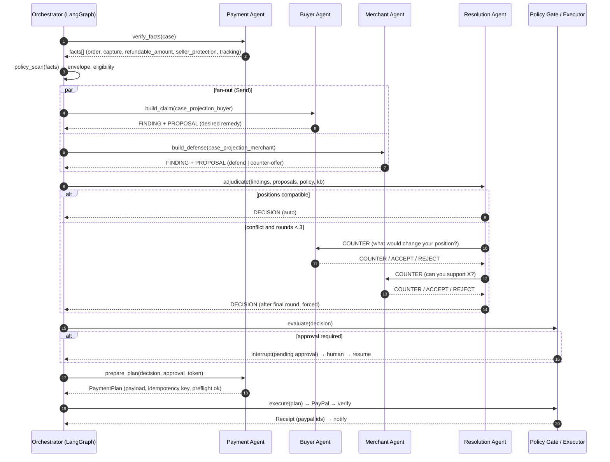

# 04 — Agents, Responsibilities & Communication Flow

## 1. Design principle

The four agents are **role-bound analysts over one shared case file**, not a free-for-all chat. Each has
(a) a distinct objective, (b) a tool allowlist it cannot escape, (c) a typed output schema, and (d) an
explicit authority limit. Money moves only through a **signed execution plan** produced by the Payment
Agent, validated by the policy gate, and consumed by `execution_service`.

| Agent | Role | Objective function | Authority |
|---|---|---|---|
| **Buyer Agent** | Advocate for the buyer | Maximize the buyer's legitimate remedy, minimize buyer effort; detect fraud/exaggeration too | Can *propose* remedies. Cannot see merchant internal policy. Cannot execute. |
| **Merchant Agent** | Advocate for the merchant | Minimize unjustified loss while preserving the customer and seller-protection standing | Can *propose* defense/counter-offer. Cannot see the buyer's private confidence scores. Cannot execute. |
| **Resolution Agent** | Neutral adjudicator/mediator | Pick the action that is defensible under policy + evidence + PayPal rules, with calibrated confidence | Decides. Does not touch PayPal. Cannot execute. |
| **Payment Agent** | Executor/treasurer | Make the money movement correct, idempotent, and verifiable | Prepares + verifies; signs the execution plan. Executes *only* with an approval token from the gate. |

**Information asymmetry is intentional** (and makes the demo compelling): the Buyer agent never reads the
merchant's refund policy or profit data; the Merchant agent never reads the buyer's internal risk score.
Each sees a redacted projection of the case file. The Resolution Agent sees both plus the policy engine output.

## 2. Shared state (`DisputeState`)

LangGraph `TypedDict`, checkpointed to Postgres. Additive reducers for lists.

```
case            : CaseFile          # normalized dispute + order + capture + buyer + policy snapshot
facts           : list[Fact]        # verified, each with source + paypal_ref or evidence_id
facts_gaps      : list[Gap]         # what's missing and who can get it
findings        : list[Finding]     # additive (reducer: operator.add)
proposals       : list[Proposal]    # additive, round-tagged
policy          : PolicyResult      # deterministic: eligibility, envelope, approval requirement
decision        : Decision | None
payment_plan    : PaymentPlan | None
budget          : Budget            # tokens, tool_calls, rounds, started_at, deadline
messages        : list[AgentEnvelope]  # full transcript (also mirrored to agent_messages)
errors          : list[AgentError]
human_verdict   : HumanVerdict | None
```

Everything serializable (no ORM objects, no clients) so checkpoints replay.

## 3. Typed message protocol (`AgentEnvelope`)

All inter-agent communication uses this. Free text is confined to `rationale` (max 2k chars, stored, shown,
never parsed).

```json
{
  "id": "msg_01J...", "run_id": "r_01J...", "seq": 7,
  "from": "buyer", "to": "resolution",
  "type": "PROPOSAL",
  "claim": "Buyer never received the item; requests full refund of 80.00 USD.",
  "evidence_refs": ["ev_9f2", "paypal:capture:CAP-123"],
  "confidence": 0.86,
  "constraints": { "max_amount": 80.00, "acceptable_resolutions": ["REFUND_FULL"] },
  "requested_action": { "action": "REFUND", "amount": 80.00, "currency": "USD" },
  "rationale": "Tracking shows label created but no carrier acceptance scan; buyer's message timeline is consistent."
}
```

`type ∈ {FINDING, QUESTION, PROPOSAL, COUNTER, ACCEPT, REJECT, VETO, DECISION}`.
Validation (`pydantic` + custom): `evidence_refs` must resolve to an entity actually visible to the sender
(otherwise the message is rejected and the agent gets a retry with the validation error). Confidence must be
in `[0,1]`. `requested_action` must be inside the agent's allowlist or it is stripped and logged as
`blocked_by_policy`.

## 4. Communication flow



Key rules:
1. **Fan-out then join.** Buyer and Merchant run in parallel (`Send`) — independent perspectives, no anchoring.
   They never message each other directly; all cross-examination goes through the Resolution Agent (prevents
   adversarial escalation and infinite loops).
2. **Bounded rounds.** Max 3 negotiation rounds, 2 counters each. Round 4 is forbidden by `budget_guard`;
   the Resolution Agent must then decide with available evidence.
3. **Termination is structural, not prompt-based.** `routing.py` owns the exit conditions: decision reached,
   budget exhausted, policy denied, or deadline pressure (`hours_left < 2` → decide now, escalate if unsure).
4. **Escalation ladder.** `confidence ≥ 0.80 and amount ≤ cap` → auto-execute. `0.55–0.80` → human approval.
   `< 0.55` or conflicting hard evidence or fraud indicators → `DEFEND`/`ESCALATE` with a human review packet.
5. **Every message is persisted** (`agent_messages`) and streamed (`run.step` SSE) — the UI's "negotiation"
   tab is the transcript, not a log file.

## 5. Agent specifications

### 5.1 Buyer Agent — `buyer.py`

**Inputs:** dispute reason + buyer message thread, order/capture basics, evidence the *buyer* provided, prior
buyer history (counts only), product info. **Redacted:** merchant policy, merchant margin, internal risk notes.

**Job:** turn messy buyer language into a precise, evidence-anchored claim; classify the *real* reason
(PayPal reason codes are frequently wrong — e.g. "not as described" filed for a non-delivery); state the
minimum acceptable resolution and the willingness-to-escalate band.

**Tools (read-only):** `get_dispute`, `get_buyer_messages`, `get_order_summary`, `get_evidence(shared_with_buyer)`,
`search_kb(buyer_faq)`, `translate` (optional).
**Cannot:** see merchant policy, call any PayPal write, see other agents' confidence, contact the buyer directly
outside the thread.

**Output:** `FINDING` (claimed facts + which are corroborated), `PROPOSAL` (`REFUND_FULL|REFUND_PARTIAL|REPLACEMENT|
NO_REMEDY`, amount, `constraints.acceptable_resolutions`), confidence, rationale.

**Guardrail:** if the buyer's own evidence contradicts the claim (e.g. buyer says "never arrived" but
messages "thanks, got it"), the agent must emit `FINDING` with `contradiction: true` — it is not a
loyalty-before-truth agent. This is a demo highlight.

### 5.2 Merchant Agent — `merchant.py`

**Inputs:** merchant policy + KB (refund/return/shipping rules), fulfillment evidence (tracking, POD,
delivery scan, correspondence), product catalog, seller-protection status, prior refunds for this buyer.
**Redacted:** buyer's internal confidence, buyer risk score, Resolution agent's leaning.

**Job:** build the strongest *honest* defense; identify which policy clauses apply; compute a counter-offer
that is cheaper than the expected loss but acceptable to the buyer; flag when defending is
commercially irrational (cost of defense > dispute amount → recommend accepting).

**Tools (read-only):** `get_tracking`, `get_fulfillment_docs`, `get_merchant_policy`, `search_kb`,
`get_prior_refunds(buyer)`, `estimate_defense_cost` (static heuristics), `get_seller_protection`.
**Cannot:** see buyer internals, execute refunds, edit evidence.

**Output:** `FINDING` (defense facts, each with source), `PROPOSAL` (`DEFEND|OFFER_PARTIAL|ACCEPT_CLAIM`, amount,
`constraints.min_amount`), confidence, rationale, `evidence_gaps` (what the merchant should upload).

**Guardrail:** a defense claim without a resolvable `evidence_ref` is rejected (hallucinated tracking numbers
are the #1 failure mode of merchant-side agent demos).

### 5.3 Resolution Agent — `resolution.py`

**Inputs:** both agents' envelopes, verified facts, deterministic `PolicyResult`, KB, cost model, deadline.
**Job:** adjudicate. Choose `REFUND_FULL | REFUND_PARTIAL | OFFER_PARTIAL | DEFEND | ESCALATE | NO_ACTION`;
calibrate confidence; cite evidence per claim; write the human-readable rationale that a support agent could
paste into a customer email. Where the facts are ambiguous, prefer the option that minimizes *expected total
cost* (amount + PayPal fee risk + churn risk) subject to policy.

**Reasoning pattern:** (1) restate the dispute in one line; (2) list decisive facts with citations; (3) apply
the policy rules in priority order; (4) resolve conflicts explicitly ("tracking says delivered to ZIP 94107,
buyer claims ZIP 94110 — address mismatch is not covered"); (5) choose action from the *allowed set only*;
(6) compute confidence from evidence coverage, not vibes.

**Tools:** `search_kb(policy)`, `get_cost_model`, `compare_evidence`, `get_policy_eval`. **No PayPal tools at all.**

**Output:** `DECISION` envelope → `Decision` row. Must include `cited_evidence[]` (min 1) and
`rejected_alternatives[]` with one-line reasons (this is what makes the demo credible to judges).

**Guardrail:** the chosen action must be inside `policy.allowed_actions`, else the gate rewrites to the
nearest allowed action and marks `policy_clamped: true` (visible in UI).

### 5.4 Payment Agent — `payment.py`

**Inputs:** approved decision, capture facts, currency, prior refunds, approval token.
**Job:** (a) fact verification for everyone (the "treasury" read path); (b) pre-flight validation —
refundable balance, currency match, capture still refundable, dispute not already resolved/closed elsewhere;
(c) build the exact payload + idempotency key; (d) post-execution verification (refund status, dispute status
flip, ledger consistency).

**Tools:** `paypal.get_order`, `paypal.get_capture`, `paypal.get_refund_status`,
`paypal.get_dispute` (read), `ledger.check_refundable`. **Write:** none directly — it returns a `PaymentPlan`;
`execution_service` performs the POST with the HMAC-signed plan.

**`PaymentPlan`** (the only currency of money movement):
```json
{ "plan_id":"pp_1", "decision_id":"dec_1", "action":"REFUND",
  "endpoint":"POST /v2/payments/captures/CAP-123/refund",
  "body": {"amount":{"currency_code":"USD","value":"80.00"},"note_to_payer":"..."},
  "amount": 80.00, "currency":"USD",
  "idempotency_key": "dispute:d_1:decision:dec_1",
  "preflight": {"refundable_before":80.00,"refundable_after":0.00,"seller_protection":"ELIGIBLE"},
  "approval_token": "hmac-sha256:...", "expires_at":"..." }
```
Executor refuses if: token invalid/expired, plan amount ≠ approved amount, decision not `approved`,
idempotency key already used with a different body (`IDEMPOTENCY_CONFLICT`), or autonomy disabled.

**Guardrail:** Payment Agent may *downgrade* an amount (never upgrade); any upgrade requires a new gate pass.

## 6. Autonomy matrix

| Action | Buyer | Merchant | Resolution | Payment | Gate | Human |
|---|---|---|---|---|---|---|
| Read case facts | ✓ (projection) | ✓ (projection) | ✓ (full) | ✓ (full) | — | ✓ |
| Propose remedy | ✓ | ✓ | ✓ | — | — | — |
| Choose decision | — | — | ✓ | — | validate | override |
| Accept claim / refund | — | — | proposes | plans | requires | approve > cap |
| Provide evidence to PayPal | suggest | suggest | decides | plans | requires | approve |
| Escalate to PayPal claim | — | suggests | proposes | — | requires | approve |
| Execute money movement | — | — | — | signs | issues token | above cap |

Default caps (per merchant, editable): auto-refund ≤ **$50**, auto-offer ≤ **$100**, anything above → approval.
`UNAUTHORISED` and `DUPLICATE_TRANSACTION` reason codes always require approval regardless of amount (fraud
signals must not be auto-adjudicated in an MVP).

## 7. Prompt & model strategy

- **Prompts as versioned files** (`agents/prompts/{agent}/v3.md`) with front-matter: `model`, `temperature`,
  `max_tokens`, `output_schema`, `ruleset_version`. `prompt_version` recorded on every run → regressions are
  attributable.
- **Model routing:** small/fast model for extraction + classification (intake, fact triage, message parsing);
  strong model for Merchant/Resolution reasoning; deterministic templates for the final customer-facing text
  (LLM drafts, template renders — cheaper and safer).
- **Structured output enforcement:** JSON-schema function calling, one repair retry, then deterministic fallback
  (`DEFEND` + escalate to human) so a bad model day degrades gracefully rather than silently.
- **Grounding:** every factual sentence in a rationale must map to an evidence ref; a post-generation validator
  (`claim_grounding_check`) rejects unsupported claims and forces a rewrite once.
- **Prompt injection defense:** buyer messages, evidence OCR text and web content are wrapped in
  `<untrusted_input source="...">` and the system prompt forbids following instructions from that block; tools
  are allowlisted per agent so an injected "refund everything" has no callable path. Instruction-following
  checks in the eval harness include 3 injection fixtures.
- **Cost guard:** per-run budget in `Budget`; estimated cost shown in the UI next to the decision
  (judges love "this decision cost $0.04").

## 8. Failure modes and handling

| Failure | Detection | Handling |
|---|---|---|
| Schema-invalid agent output | Pydantic validation | 1 repair retry → deterministic fallback + `HUMAN_REVIEW` |
| Hallucinated evidence ref | ref resolution check | reject message, retry with error, then escalate |
| Agents deadlock (no compatible position) | round counter | Resolution Agent forced decision at round 3 with reduced confidence |
| Tool timeout / 5xx | adapter exception | retry w/ jitter (2×), then mark fact missing → confidence penalty |
| Duplicate webhook mid-run | dispute version / run lock | second run refused (`409 RUN_ALREADY_ACTIVE`) |
| Human never approves | `approvals.expires_at` (2h) | auto-escalate to human queue + notify; never auto-approve |
| PayPal already resolved the case | preflight / PayPal error code | abort, reconcile state, close run as `SUPERSEDED` |
| Model outage | provider error | fallback provider (if configured) or deterministic path |

## 9. Evaluation harness (the "is it actually good?" artifact)

`tests/evals/` with ~25 labeled fixtures across the 3 demo scenarios + adversarial cases:
metrics = decision accuracy, calibration (Brier score), evidence-citation precision, injection resistance,
cost/run, p95 latency. Run in CI on prompt changes. A `GET /admin/evals` endpoint renders the last run — a
strong differentiator in a hackathon judging conversation.
